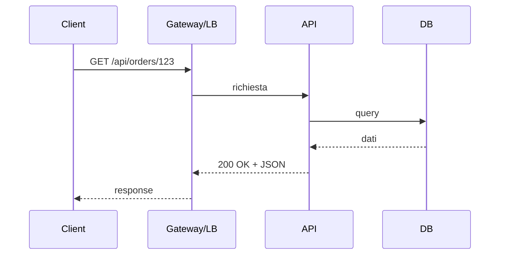
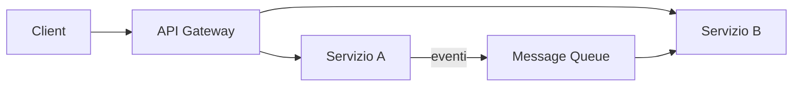

# Architettura

*Particolarmente rilevante: Mid–Senior.*

- [Panoramica](#panoramica)
- [REST](#rest)
- [Microservizi](#microservizi)
- [Event-driven e messaggistica](#event-driven-e-messaggistica)
- [CQRS e event sourcing](#cqrs-e-event-sourcing)
- [Message broker: RabbitMQ e Kafka](#message-broker-rabbitmq-e-kafka)
- [API Gateway e BFF](#api-gateway-e-bff)
- [Osservabilità e contract](#osservabilità-e-contract)
- [Versioning e idempotenza](#versioning-e-idempotenza)

## Panoramica

Questa guida copre temi tipici da senior e architect: design delle API, decomposizione in servizi, consistenza e resilienza. Fa da ponte tra backend e sistema: REST, microservizi, event-driven, CQRS e message broker sono domande ricorrenti in colloqui tecnici.

Flusso semplificato di una richiesta REST e possibili componenti:

---

## REST

### Risorse, URI e metodi HTTP

**Definizione**  
REST (Representational State Transfer) modella l’API come risorse identificabili da URI. Le operazioni sono espresse con i verbi HTTP: GET (lettura), POST (creazione), PUT (sostituzione), PATCH (aggiornamento parziale), DELETE (rimozione).

**Caso d’uso**  
API pubbliche o interne che espongono entità (ordini, utenti, prodotti). URI sostantivi e gerarchici (es. `/api/orders`, `/api/orders/123`), non verbi nell’URL.

**Esempio**

- Risorsa: ordine.  
- `GET /api/orders` — lista ordini.  
- `GET /api/orders/123` — singolo ordine.  
- `POST /api/orders` — crea ordine (body con payload).  
- `PUT /api/orders/123` — sostituisce ordine 123.  
- `PATCH /api/orders/123` — aggiorna campi di 123.  
- `DELETE /api/orders/123` — elimina 123.

Codici stato: 200 OK, 201 Created, 204 No Content, 400 Bad Request, 401 Unauthorized, 404 Not Found, 500 Internal Server Error. Content negotiation (Accept/Content-Type) per JSON, XML, ecc.

**Trade-off**  
REST è semplice e cacheabile (GET); non è adatto a query molto complesse o a grafi (valutare GraphQL). Versioning: URI (`/v1/orders`) vs header (`Accept: application/vnd.api.v1+json`); URI più esplicito, header più pulito.

**Errore tipico**  
Usare GET per operazioni con side effect; non rispettare l’idempotenza di PUT/DELETE (stesso risultato se ripetuti); ignorare i codici stato e restituire sempre 200 con errore nel body.

### Idempotenza

**Definizione**  
Un’operazione è idempotente se eseguirla più volte produce lo stesso effetto di eseguirla una volta. GET, PUT, DELETE sono idempotenti; POST crea una nuova risorsa a ogni chiamata (non idempotente). PATCH può essere idempotente se ben definito (es. “imposta campo X a valore Y”).

**Perché conta**  
Retry automatici (timeout, rete) non devono duplicare effetti (es. doppio addebito). Client e gateway possono ritentare PUT/DELETE senza logica aggiuntiva.

**Errore tipico**  
Usare POST per aggiornamenti che dovrebbero essere PUT; implementare POST che crea risorse duplicate a ogni retry invece di usare idempotency key (es. header + controllo lato server).

### Versioning API

**Definizione**  
Strategie per evolvere l’API senza rompere i client: versioning nell’URI (`/v1/orders`, `/v2/orders`), nell’header Accept, o nei parametri. Deprecation e sunset date comunicati chiaramente.

**Trade-off**  
URI: semplice, ma duplica path. Header: URI unico, client deve inviare version. Parametro: meno standard. Scelta coerente con l’organizzazione e gli strumenti (gateway, client SDK).

---

## Microservizi

### Bounded context e comunicazione

**Definizione**  
I microservizi decompongono il sistema in servizi autonomi, tipicamente allineati ai bounded context del DDD. Comunicazione sync (REST, gRPC) per richiesta/risposta; async (messaggi) per eventi e disaccoppiamento.

**Caso d’uso**  
Sistemi grandi con team multipli, deploy indipendenti, tecnologie eterogenee. Comunicazione sync quando serve risposta immediata; async per notifiche, integrazioni e riduzione dell’accoppiamento.

**Trade-off**  
Sync: semplice da debuggare, ma accoppiamento e rischio cascata (un servizio lento blocca la catena). Async: resilienza e scalabilità, ma eventual consistency e complessità operativa (messaggi, retry, idempotenza).

**Errore tipico**  
Chiamate sync a catena lunghe senza timeout e circuit breaker; trattare la comunicazione async come “fire and forget” senza garantire almeno at-least-once e idempotenza consumer.

### Saga: orchestration vs choreography

**Definizione**  
Una saga coordina più passi distribuiti senza transazione globale: ogni servizio ha una transazione locale; in caso di errore si eseguono compensazioni (rollback “logico”). Orchestration: un coordinatore (orchestrator) invoca i servizi e decide i risarcimenti. Choreography: ogni servizio pubblica eventi; gli altri reagiscono e pubblicano a loro volta, senza un centro unico.

**Caso d’uso**  
Esempio: ordine → riserva magazzino → addebita pagamento → spedizione. Se il pagamento fallisce, si compensa la riserva.

**Trade-off**  
Orchestration: controllo centralizzato, più facile da seguire e testare; singolo punto di coordinamento. Choreography: nessun bottleneck, ma flusso distribuito e più difficile da tracciare e modificare.

**Errore tipico**  
Compensazioni non idempotenti; dimenticare timeout e retry; non gestire lo stato “in sospeso” (saga non completata) con tabelle di stato o event store.

### Circuit breaker e retry

**Definizione**  
Il circuit breaker evita di chiamare ripetutamente un servizio in errore: dopo N fallimenti passa in stato “open” e fallisce subito (o restituisce fallback); dopo un timeout prova di nuovo (half-open). Retry con backoff (esponenziale) per errori transienti.

**Caso d’uso**  
Chiamate a servizi esterni o tra microservizi: evitare cascate e sovraccarico del servizio già in difficoltà.

**Best practice**  
Configurare soglie (failure count, timeout); fallback degradato dove possibile; logging e metriche per capire quando il circuit si apre. Non ritentare su errori 4xx (eccetto 429) o su errori non transienti.

**Errore tipico**  
Retry senza backoff che amplifica il carico; circuit breaker senza fallback che espone errori grezzi all’utente; non monitorare lo stato del circuit.

---

## Event-driven e messaggistica

### Pub/sub vs queue

**Definizione**  
- **Pub/sub**: un messaggio è consegnato a tutti i subscriber interessati (topic). Nessuna garanzia che qualcuno lo processi; adatto a notifiche, broadcasting.  
- **Queue**: un messaggio è consumato da un solo consumer (tra quelli che leggono dalla stessa coda). Load balancing tra consumer; adatto a task e job.

**Caso d’uso**  
Pub/sub: evento “OrdineCreato” per aggiornare dashboard, inviare email, aggiornare cache. Queue: coda “ordini-da-evasione” con N worker che prelevano messaggi.

**Trade-off**  
Eventual consistency: i consumer vedono gli eventi in ritardo; non c’è transazione distribuita. Idempotenza consumer obbligatoria (stesso messaggio può essere consegnato più volte). At-least-once vs exactly-once: exactly-once richiede deduplicazione e transazioni (complesso); at-least-once + idempotenza è il compromesso più comune.

**Errore tipico**  
Consumer non idempotenti (doppia elaborazione); assumere exactly-once senza meccanismi espliciti; non gestire il dead letter queue per messaggi falliti.

### Idempotenza consumer e deduplicazione

**Definizione**  
Elaborare lo stesso messaggio due volte deve produrre lo stesso effetto di elaborarlo una volta. Tecniche: chiave idempotenza (message id + consumer id) con tabella “già processati”; oppure operazioni naturalmente idempotenti (es. “imposta stato a X” invece di “incrementa”).

**Caso d’uso**  
Retry e re-delivery dopo crash; partizioni Kafka con più consumer che potrebbero rileggere offset.

**Errore tipico**  
“Incrementa contatore” o “inserisci riga” senza controllo duplicati; non usare la message id (o idempotency key) nella logica di deduplicazione.

---

## CQRS e event sourcing

### CQRS

**Definizione**  
CQRS (Command Query Responsibility Segregation) separa il modello di lettura da quello di scrittura: i comandi aggiornano il write model; le query leggono da read model ottimizzati (viste, cache, altro DB). I due modelli possono essere sincronizzati con eventi o job batch.

**Caso d’uso**  
Query complesse e report molto diversi dalle operazioni di scrittura; necessità di scalare letture e scritture in modo indipendente; ottimizzazione dei read model per casi d’uso specifici (es. dashboard, full-text).

**Trade-off**  
Complessità: due modelli da mantenere, eventual consistency tra write e read. Beneficio: libertà di modellare le letture senza vincoli del modello di scrittura; scaling e caching dedicati.

**Errore tipico**  
Introdurre CQRS per sistemi semplici dove un unico modello basta; non accettare la eventual consistency e cercare letture sempre aggiornate dal write model senza strategia chiara.

### Event sourcing (cenni)

**Definizione**  
Lo stato dell’applicazione non è memorizzato come “stato attuale”, ma come sequenza di eventi immutabili. Lo stato corrente si ottiene applicando (replay) gli eventi. Gli eventi sono la fonte di verità; si possono derivare più proiezioni (read model) e audit trail completo.

**Caso d’uso**  
Domini con forte bisogno di audit, compliance, analitica storica; necessità di “riavvolgere” e ricalcolare proiezioni; time travel e analisi del passato.

**Trade-off**  
Complessità di storage, versioning degli eventi, snapshot per evitare replay lunghi. Non adatto a tutti i contesti: valutare costo vs beneficio.

**Errore tipico**  
Adottare event sourcing “per moda” senza requisiti chiari di audit o riplay; non definire strategia di snapshot e versioning degli eventi.

---

## Message broker: RabbitMQ e Kafka

### RabbitMQ: exchange, queue, binding

**Definizione**  
RabbitMQ è un message broker: i producer inviano messaggi a un **exchange**; l’exchange instrada i messaggi alle **queue** in base al **binding** (e tipo di exchange: direct, topic, fanout). I consumer leggono dalle queue; il broker gestisce ack, re-delivery e dead letter.

**Caso d’uso**  
Task queue (un messaggio = un job), routing per topic (es. `order.created`), broadcast (fanout). Adatto a volumi moderati e latenza bassa, pattern request/reply possibile.

**Snippet concettuale**  
Exchange `orders` (topic) → binding `order.created` → queue `notifications`; binding `order.*` → queue `analytics`. I consumer sottoscrivono le queue.

### Kafka: topic, partition, consumer group

**Definizione**  
Kafka è un log distribuito: i messaggi sono scritti in **topic** divisi in **partition**; ogni partition è un log ordinato. I **consumer group** condividono il lavoro: ogni partition è letta da un solo consumer del gruppo. Offset per riprendere da dove si era.

**Caso d’uso**  
Stream di eventi ad alto throughput, retention lunga, rilettura (replay), integrazione tra molti produttori e consumer. Meno adatto a pattern request/reply o code “classiche” con ack per messaggio.

**Confronto sintetico**

| Aspetto       | RabbitMQ              | Kafka                    |
|---------------|-----------------------|--------------------------|
| Modello       | Queue / exchange      | Log partizionato         |
| Retention     | Fino a consumo        | Configurabile (giorni)  |
| Throughput   | Buono                 | Molto alto               |
| Latenza      | Bassa                 | Bassa ma log-oriented   |
| Replay        | No (di default)       | Sì (offset)              |

**Quando RabbitMQ vs Kafka**  
RabbitMQ: task queue, routing complesso, priorità, TTL per messaggio, volumi non estremi. Kafka: event streaming, retention, molti consumer che rileggono, throughput molto alto.

**Guide dedicate**  
Per approfondire: [Kafka](kafka.md) (topic, partition, consumer group, offset, retention) e [RabbitMQ](rabbitmq.md) (exchange, queue, binding, DLQ). Vedi anche [Event-driven e messaggistica](#event-driven-e-messaggistica) per consistenza, idempotenza e pattern comuni.

---

## API Gateway e BFF

### API Gateway
**Definizione**  
L'API Gateway è un punto di ingresso unico per le richieste client verso i microservizi: routing (path → servizio), aggregazione, autenticazione/autorizzazione, rate limiting, terminazione TLS, logging.

**Caso d'uso**  
Frontend unico che chiama N servizi; centralizzare auth (JWT validation, OAuth) e rate limit; nascondere topologia interna; offload (cache, compressione).

**Trade-off**  
Single point of failure e bottleneck se non scalato; complessità operativa. Quando introdurlo: quando i client chiamano più servizi direttamente e si vuole centralizzare policy e osservabilità.

**Esempio**  
Kong, AWS API Gateway, Nginx: routing per path (`/api/orders` → order-service), plugin per auth e limit.

### Service mesh (cenni)
**Definizione**  
Il service mesh (Istio, Linkerd) gestisce il traffico tra servizi in rete: discovery, load balancing, retry, circuit breaker, mTLS, osservabilità (metriche, trace) tramite sidecar proxy accanto a ogni pod.

**Caso d'uso**  
Microservizi in Kubernetes; policy di traffico (canary, A/B); sicurezza zero-trust (mTLS) senza cambiare codice applicativo.

**Trade-off**  
Complessità e risorse (CPU/memoria per sidecar); adatto quando il numero di servizi e la necessità di osservabilità e sicurezza giustificano l'overhead.

### Backend for Frontend (BFF)
**Definizione**  
Il BFF è un layer backend dedicato a un tipo di client (es. web, mobile): aggrega chiamate a più microservizi, adatta il formato e riduce round-trip. Ogni BFF espone un'API ottimizzata per quel client.

**Caso d'uso**  
Quando web e mobile hanno esigenze diverse (campi, paginazione, aggregazioni); quando si vuole evitare che il client chiami molti servizi e si assume la complessità di orchestrazione lato server.

**Trade-off**  
Un BFF in più da mantenere e deployare; duplicazione logica se ci sono più BFF. Quando: multipli client con bisogni distinti e servizi granulari.

---

## Osservabilità e contract

### Strumentazione e distributed tracing
**Definizione**  
Il tracing distribuito associa a ogni richiesta un correlation ID (trace ID) e propaga lo span attraverso i servizi; ogni operazione registra span con durata e attributi. Standard: OpenTelemetry; backend: Jaeger, Zipkin, Datadog.

**Caso d'uso**  
Debug di latenza end-to-end; capire quale servizio o query è lento; correlare log tra servizi con lo stesso trace ID.

**Trade-off**  
Overhead (CPU, storage); sampling per ridurre volume. Best practice: trace ID in header (es. `traceparent`), iniettato dal gateway o dal primo servizio; propagazione in chiamate downstream.

### Contract testing (consumer/provider)
**Definizione**  
Il contract testing verifica che consumer e provider rispettino un contratto (schema richiesta/risposta). Pact: il consumer definisce le attese; si genera un pact file; il provider verifica contro il pact. Integrazione in pipeline: prima del deploy.

**Caso d'uso**  
Microservizi con team diversi; evitare breaking change non scoperti fino all'integrazione. Non sostituisce i test E2E ma riduce sorprese a runtime.

**Trade-off**  
Setup e manutenzione dei contract; contract troppo rigidi che bloccano evoluzione. Best practice: versioning del contract; verificare provider su ogni cambio pact.

---

## Versioning e idempotenza

### Strategie di versioning API (URL, header, content negotiation)
**Definizione**  
- **URL**: `/v1/orders`, `/v2/orders` — chiaro, cache-friendly; più endpoint da mantenere.  
- **Header**: `Accept: application/vnd.api+v1` — stesso URL, contenuto diverso; richiede supporto client.  
- **Content negotiation**: stesso endpoint, risposta in base ad Accept; per formati (JSON vs XML) più che per versioni logiche.

**Caso d'uso**  
Breaking change: nuova versione; deprecation della vecchia con sunset. Scegliere una strategia e mantenerla; documentare breaking change.

### Idempotency key per API e consumer
**Definizione**  
L'idempotency key è un identificatore (header o body) che il client invia per operazioni che non devono essere applicate più volte (es. pagamento, creazione ordine). Il server memorizza (key → risultato) e per richieste ripetute con la stessa key restituisce lo stesso risultato senza rieseguire.

**Caso d'uso**  
Retry sicuro su POST; consumer di messaggi che processano exactly-once (key = message ID o business ID). Design: key univoca per operazione business; retention limitata (TTL); 409 se key già usata con payload diverso.

**Trade-off**  
Storage e lookup; definire scope (per utente, globale). Best practice: header `Idempotency-Key`; risposta 200 con stesso body per retry; 201 solo alla prima creazione.

## In sintesi

- REST: risorse, URI, metodi HTTP; idempotenza di GET/PUT/DELETE; versioning e codici stato.
- Microservizi: decomposizione per bounded context; resilienza (retry, circuit breaker), osservabilità.
- Event-driven: eventual consistency; idempotenza consumer; event sourcing e CQRS per lettura/scrittura separata.
- RabbitMQ: queue, exchange, binding; task queue e routing. Kafka: log, partition, consumer group; throughput e replay.
- API Gateway: routing, auth, rate limit; Service mesh per traffic e mTLS; BFF per client specifici; tracing (OpenTelemetry) e contract testing (Pact); versioning API e idempotency key.

## Vedi anche

- [Database](database.md) — Consistenza e transazioni.
- [Sicurezza](sicurezza.md) — Auth e API sicure.
- [Pipeline](pipeline.md) — Deploy e release.
